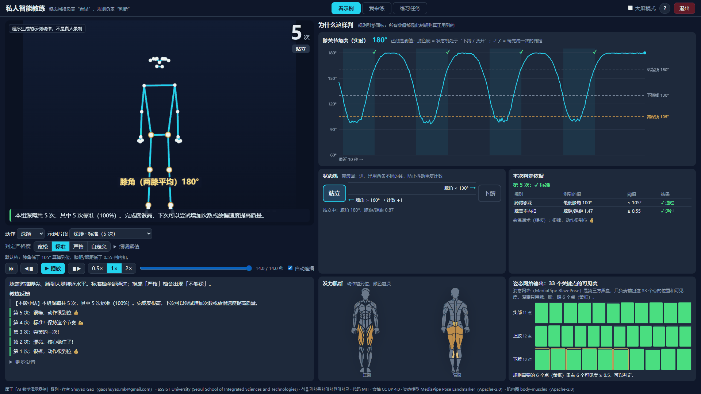
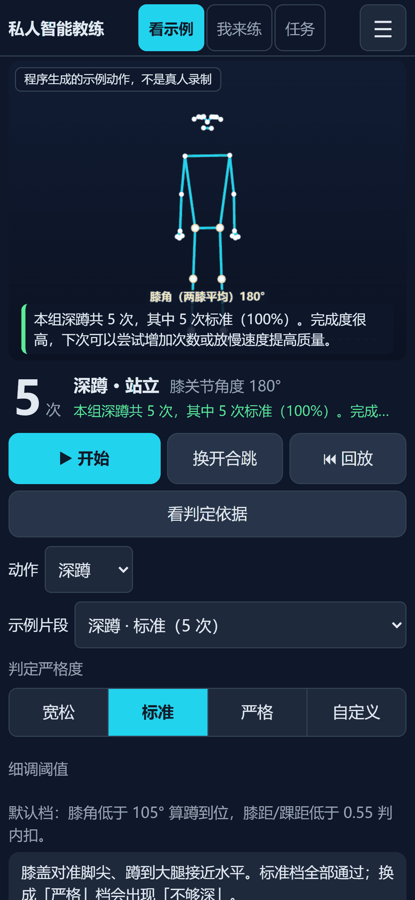
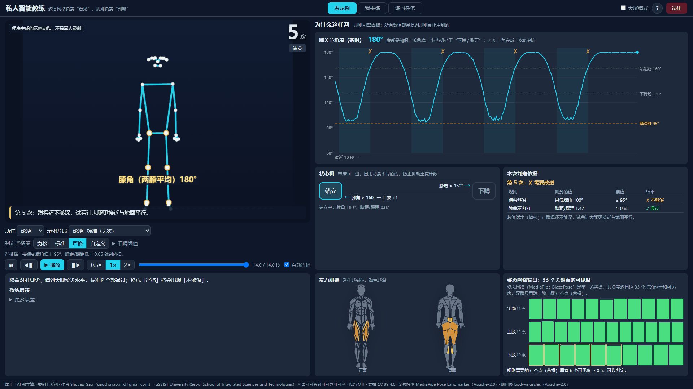
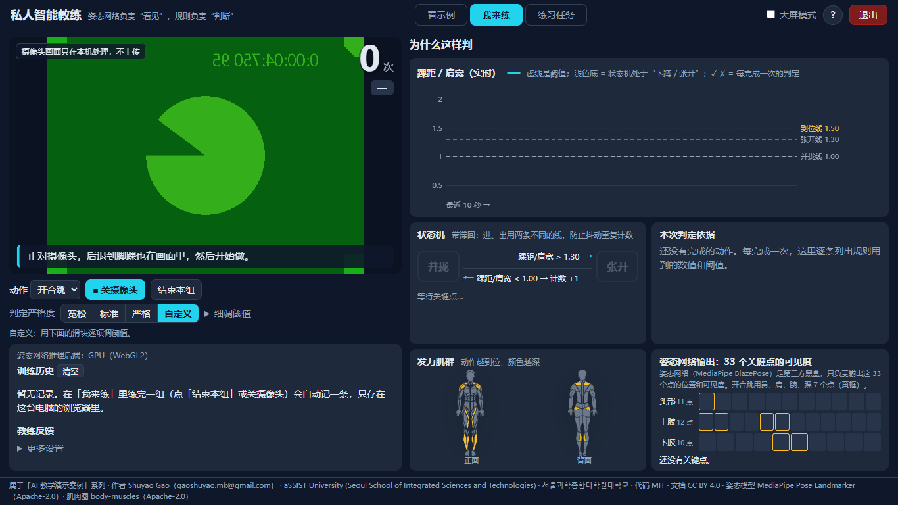

> **AI 教学演示案例 / AI Teaching Demos** 系列

# 私人智能教练 · Pose Fitness Coach

**Shuyao Gao**（gaoshuyao.mk@gmail.com）· aSSIST University (Seoul School of Integrated Sciences and Technologies) · 서울과학종합대학원대학교
代码 MIT · 文档与教学素材 CC BY 4.0

**摄像头里的人做深蹲、开合跳，网页实时计数并指出动作问题，而且把“为什么这样判”一条条摆出来。**

这个案例想让同学看清一件事：**AI 只负责“看见”，判断标准是人写的规则。**
一个现成的姿态神经网络（Google MediaPipe Pose Landmarker，BlazePose）把每一帧画面变成 33 个身体关键点；
之后的计数和纠错全部由本项目自己写的几何规则和状态机完成，每个阈值都看得见、改得了。
同一段动作，把判定阈值调严一点，结论就跟着变。电脑和手机都能直接打开：不安装、不联网，所有计算都在你的浏览器里。



## 怎么打开（不用安装，也不用联网）

- **手机**：打开在线链接 <https://shuyaogao.github.io/pose-fitness-coach/>（竖屏）。
- **电脑**：打开同一个在线链接 <https://shuyaogao.github.io/pose-fitness-coach/>；
  或在 [Releases](https://github.com/ShuyaoGao/pose-fitness-coach/releases) 下载 `pose-fitness-coach-v1.0.zip`（约 10.3 MB），解压后双击 `index.html`；
  或仓库首页点 **Code → Download ZIP**，解压后双击 `play/index.html`。

Windows 用自带的 Edge 打开，Mac 用 Safari 打开。**一定要先解压**，不要在压缩包里直接双击。

> 摄像头说明：在 Windows 的 Edge 里用 file:// 打开时，已用无界面 Edge 自动测试通过（假摄像头）。
> **Safari 在 file:// 下能否打开摄像头尚未在真机上确认**；如果打不开，请改用上面的在线链接。
> 没有摄像头也没关系：「看示例」和「练习任务」两个模式都不需要摄像头。Firefox 未测试。

## 怎么用

页面顶部有三个模式标签，打开时默认是「看示例」，会自动连播：

| 模式 | 你能做什么 |
|---|---|
| **看示例**（默认） | 播放程序合成的骨架动作（**程序生成，不是真人录制**），一共 7 段：深蹲的标准 / 蹲太浅 / 膝盖内扣 / 脚出了画面，开合跳的标准 / 手没举过头顶 / 腿没跳开。规则引擎在浏览器里对每一帧实时运行，次数和判定都是当场算出来的。**判定严格度**四档（宽松 / 标准 / 严格 / 自定义，自定义可以用滑块逐项调阈值），切换后同一段动作按新阈值从头重算 |
| **我来练** | 打开摄像头自己做。正对镜头，后退到从头到脚踝都在画面里。摄像头画面只在本机处理，不上传；练完一组点「结束本组」记进训练历史（只存在这台设备的浏览器里） |
| **练习任务** | 7 项任务清单，完成一项自动打勾，例如“把严格度调到「严格」，让「深蹲 · 标准」出现「不够深」” |

**规则引擎面板**（电脑在右栏，手机点「看判定依据」全屏打开）有四块：

1. 实时指标曲线（深蹲是膝关节角度，开合跳是踝距 ÷ 肩宽），虚线是阈值，✓ ✗ 是每一次的判定；
2. 状态机（站立 ⇄ 下蹲 / 并拢 ⇄ 张开），当前状态高亮，箭头上写着翻转条件；
3. 本次判定依据：每条规则用到的数值、阈值、结果；
4. 发力肌群高亮，以及姿态网络输出的 33 个关键点可见度（规则用到的点有黄框）。

### 电脑（键盘鼠标）

左栏上方是画面，下方是动作、示例片段、判定严格度、播放 / 暂停 / 逐帧 / 0.5×–2× 速度；右栏是规则引擎面板。
把鼠标停在按钮上会弹出带动画的小提示。

| 按键 | 作用 |
|---|---|
| 空格 | 看示例：播放 / 暂停 |
| → / ← | 前进 / 后退一帧（暂停后一帧一帧看状态机在哪一帧翻转） |
| B | 大屏模式（左右比例约 45:55 → 35:65，适合投影） |
| H | 再次打开操作说明 |

右上角「退出」会停止所有计算（摄像头、定时器、语音），显示“已停止运行”。

### 手机（触屏，竖屏）

头部一行：标题、三个模式标签、☰ 菜单（操作说明、看判定依据、更多设置、退出）。
上方是按手机宽度缩放的画面（「我来练」用前置摄像头，像照镜子一样），下面是次数和状态大字，
再下面是大按钮「开始 / 暂停」「换动作」「回放」和「看判定依据」（全屏打开规则引擎面板，「返回」关闭）。
整页不滚动；再往下滑的小区域里是示例片段、判定严格度、任务清单和教练反馈。
没有给摄像头权限也没关系：「看示例」和「练习任务」照常可用。横屏时会提示竖屏体验更佳（也可以选择继续）。
手机上不需要键盘，第一次打开弹出的说明是触屏图解。



## 课堂上怎么用（推荐顺序）

1. 打开页面，让「深蹲 · 标准」自动播放：看曲线穿过 130° 的下蹲线，状态机翻到“下蹲”；回到 160° 以上，次数 +1。
2. 让它自动连播到「蹲太浅」：最低点停在 105° 的蹲深线上方，判定依据给出“✗ 不够深”。
3. 回到「深蹲 · 标准」，把严格度换成「严格」：**同一段动作**，5 次全部变成“不够深”。讨论：标准是谁定的？

   

4. 播放「脚出了画面」：一次也不计数。看右下角关键点可见度，解释“宁可不判，也不乱判”。
5. 切到开合跳，看「手没举过头顶」：这条规则没有阈值可调，只看双腕是否高于鼻子。
6. 有摄像头的话，请一位同学到「我来练」现场做几个；或者让同学用自己的手机打开在线链接，竖屏对着自己做。

## 它是怎么做的

```
摄像头画面 ──► 姿态网络（MediaPipe BlazePose，第三方，已训练好）──► 33 个关键点 (x, y, 可见度)
                                                                    │
示例片段（程序合成的 33 个关键点）────────────────────────────────────┤
                                                                    ▼
                                 规则引擎（本项目自写）：关节角度 / 距离比 → 带滞回的状态机
                                                                    │
                                     计数 + 纠错标签 ──► 模板话术 / 语音 / 肌肉高亮 / 训练历史
```

- **姿态网络是第三方黑盒**：本项目没有训练任何模型，用的是 Google 发布的 `pose_landmarker_lite.task`（Apache-2.0）。
- **规则是本项目的核心**（`src/exercises/squat.js`、`src/exercises/jumpingJack.js`）。默认阈值：
  深蹲 膝角 < 130° 进入下蹲、> 160° 站起并计数；最低膝角 > 105° 判“不够深”；膝距/踝距 < 0.55 判“膝盖内扣”。
  开合跳 踝距/肩宽 > 1.3 进入张开、< 1.0 并拢并计数；张开峰值 < 1.6 判“张开不足”；双腕没高过鼻子判“手没举过头顶”。
  上下两条线不同（滞回），关键点在临界值附近抖动时不会重复计数。
- **大模型只负责说话，不负责判断**：组总结可以交给本机的 Ollama 润色（默认关闭），喂给它的只是规则已经判好的事实。

示例片段在三个档位下的结果（来源：[`results/result.json`](results/result.json)，由 `node tools/replay_report.mjs` 生成，可重复）：

| 片段 | 宽松 | 标准 | 严格 |
|---|---|---|---|
| 深蹲 · 标准（5 次） | 5/5 标准 | 5/5 标准 | 0/5（5 次不够深） |
| 深蹲 · 蹲太浅（4 次） | 4/4 标准 | 0/4（4 次不够深） | 0/4 |
| 深蹲 · 膝盖内扣（4 次） | 4/4 标准 | 0/4（4 次内扣） | 0/4 |
| 深蹲 · 脚出了画面 | 不计数 | 不计数 | 不计数 |
| 开合跳 · 标准（6 次） | 6/6 标准 | 6/6 标准 | 0/6（6 次张开不足） |
| 开合跳 · 手没举过头顶（5 次） | 0/5 | 0/5 | 0/5 |
| 开合跳 · 腿没跳开（5 次） | 5/5 标准 | 0/5（5 次张开不足） | 0/5 |

“宽松 / 严格”只改判定阈值（见 `play_src/presets.js`），不改计数阈值，所以三档的次数相同。

**为什么离线网页能跑姿态网络**：双击打开的 file:// 页面不能读取本地文件，
所以构建脚本把 MediaPipe 的 WASM 运行时（11,153,617 字节）和模型（5,777,746 字节）转成 base64 写进 `.js`，
用普通 `<script>` 加载（只在第一次进入「我来练」时加载）。play/ 合计 23.3 MB，Release zip 10.3 MB
（来源：[`results/build_info.json`](results/build_info.json)）。第三方文件都没有修改，见 [THIRD_PARTY.md](THIRD_PARTY.md)。



## 想自己修改

需要 Node.js ≥ 20.19；浏览器验收另需 Python 3 和 `pip install playwright`（用本机已装的 Edge，不下载浏览器）。

```bash
npm install                      # 安装依赖（MediaPipe、body-muscles、Vite）
npm run dev                      # 开发版：http://localhost:5173/dev.html（摄像头 + 姿态网络 + 规则）
npm test                         # 规则、阈值、示例片段的单元测试（不需要浏览器）
python tools/build.py --release  # 一条命令重建 play/、results/ 和 release/*.zip（zip = play/ + 根目录 index.html）
python tools/browser_check.py --shots docs/img     # 电脑 1920×1080 / 1366×768：全部操作 + 假摄像头 + 截图
python tools/mobile_check_pfc.py --shots docs/img  # 手机 390×844 / 414×896 / 360×780 / 768×1024 + 电脑两种尺寸
python -m pytest -q              # 静态规则检查 + 上面的浏览器验收（没有 playwright / Edge 时自动跳过）
```

- 改规则：`src/exercises/*.js`（阈值都在文件顶部）。改完跑 `npm test`，再 `python tools/build.py`。
- 加示例片段：`play_src/replayGen.js` 的 `CLIPS`，然后 `node tools/replay_report.mjs` 更新结果。
- 手机布局：`play_src/style.css` 末尾 `body.touchp` 一节，通用工具在 `play_src/mobile.js`。
- 本机大模型点评（可选，默认关）：安装 [Ollama](https://ollama.com/) 并 `ollama pull qwen3:4b`，在页面「更多设置」里打开。
  浏览器会以网页的来源访问 `http://localhost:11434`，需要用环境变量 `OLLAMA_ORIGINS` 允许这个来源
  （在线版是 `https://shuyaogao.github.io`，双击打开的本地页面来源是 `null`）。**这一功能在发布版里没有实测**；连不上时自动使用模板话术。

## 目录结构

```
index.html         根目录入口：自动跳到 play/index.html（GitHub Pages 和解压后双击都从这里进）
play/              离线网页包（GitHub Pages 和 Release zip 用的就是它；由 tools/build_play.mjs 生成）
play_src/          网页包源代码：app.js（界面与面板）、mobile.js（手机竖屏）、replayGen.js（示例动作合成）、presets.js、poseEngine.js
src/               规则引擎与通用模块（开发版 npm run dev 也用它们）
  exercises/       ★ 深蹲、开合跳的规则状态机
dev.html           开发版入口（npm run dev）
public/models/     姿态模型 pose_landmarker_lite.task（Google，Apache-2.0）
tests/             单元测试（Node）+ 发布规则检查与浏览器验收（pytest）
tools/             构建、结果报告、署名填充、浏览器验收（电脑 + 手机）脚本
results/           result.json（示例片段在各档位的判定结果）、build_info.json（构建产物大小与来源 md5）
docs/img/          截图（电脑和手机）
```

## 常见问题

- **关掉页面后还有程序在跑吗？** 没有。离线版是纯静态网页，关掉标签页就全部结束，不留后台进程；右上角「退出」（手机在 ☰ 里）也会先停止所有计算。
- **我的动作数据会上传吗？** 不会。摄像头画面只在浏览器里处理；训练历史只存在这台设备的浏览器里（localStorage），可在「我来练」里清空。
- **手机上怎么用？** 竖屏打开在线链接；顶部标签切模式，大按钮「开始 / 暂停」「换动作」「回放」，「看判定依据」打开面板，☰ 里有说明和退出。横屏会提示竖屏更好用。
- **手机上摄像头打不开？** 浏览器会先询问权限，拒绝后可以在地址栏的设置里重新允许；iPhone 需要 iOS 15 以上的 Safari。打不开时「看示例」和「练习任务」照常可用。
- **为什么只有深蹲和开合跳？** 这两个动作正对摄像头就能用二维关键点稳定判断。弯腰、前倾这类需要深度信息的问题，单个普通摄像头测不准，所以没有做。
- **能当专业健身指导吗？** 不能。这是课堂演示，阈值是为了讲清原理设定的，没有经过运动医学验证。

## 许可证与引用

代码 MIT（[LICENSE](LICENSE)），文档和教学素材（README、docs/、页面说明文字、截图）CC BY 4.0（[LICENSE-docs](LICENSE-docs)），使用请注明出处。
第三方组件见 [THIRD_PARTY.md](THIRD_PARTY.md)。GitHub 页面右侧的 “Cite this repository” 可以直接生成引用格式（[CITATION.cff](CITATION.cff)）。
联系作者：gaoshuyao.mk@gmail.com。

## AI 辅助开发声明

代码由 Claude Code 辅助编写，经作者审阅。

## English summary

**Pose Fitness Coach** is a browser-only teaching demo from the *AI Teaching Demos* series by Shuyao Gao (aSSIST University (Seoul School of Integrated Sciences and Technologies)).
A pretrained pose network (Google MediaPipe Pose Landmarker / BlazePose) turns each camera frame into 33 body keypoints,
and a small hand-written rule engine (joint angles, distance ratios and a hysteresis state machine) counts squats and
jumping jacks and flags form problems. The "rule engine panel" shows exactly why each repetition was accepted or rejected:
the live metric curve with its thresholds, the current state, and a per-rule verdict table. Seven procedurally generated
skeleton clips (not recordings of real people) let you explore everything without a camera, and switching between
loose / standard / strict thresholds shows how the same motion gets different verdicts. Works on phones in portrait
(front camera, big buttons, full-screen panel) and on desktops; open <https://shuyaogao.github.io/pose-fitness-coach/>, or unzip the release and double-click
`index.html` to run it offline. Code is MIT; docs are CC BY 4.0. Contact: gaoshuyao.mk@gmail.com.
